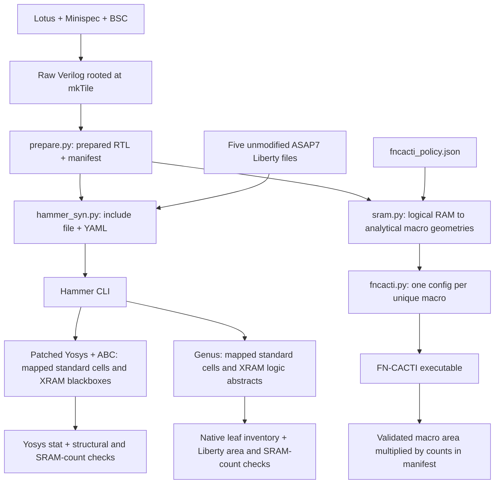

# What the ASIC folder adds

This is the implementation review guide. [README.md](README.md) covers setup
and commands; [FNCACTI.md](FNCACTI.md) owns the detailed SRAM mapping/model
assumptions. The top-level result is **one tile's standard-cell area plus a
separate, uncalibrated SRAM estimate**.

## Reused tools versus our code

| Component | Reused implementation | Additional work maintained here |
|---|---|---|
| RTL generation | Lotus, Minispec and Bluespec | An `asic-tile` branch in [SConstruct](../../SConstruct) consumes raw BSC output and avoids unrelated software/FPGA tool bootstrap |
| RTL preparation | BSC-generated modules and generic BSC FIFO libraries | [prepare.py](prepare.py) traverses `mkTile`, counts hierarchy instances, removes incoming Verilog attributes, guards simulation regions and packages the required sources |
| Support logic | Original RTL under [lotus/utils](../../lotus/utils) and [XRegFile.sv](../../lotus/xram/XRegFile.sv) | Source guards disable FPGA power-up initialization for ASIC area synthesis and omit simulation diagnostics; no duplicated implementations or added reset ports |
| SRAM exclusion | Yosys `blackbox`/`keep`; Genus logic abstracts and `preserve` | [rtl/memory_blackboxes.sv](rtl/memory_blackboxes.sv) declares the three XRAM interfaces |
| Library preparation | Upstream ASAP7 v28 libraries, LEF and native libarchive | [libraries.py](libraries.py) extracts five RVT TT groups, checks Liberty area against native LEF, and records provenance; it does not rewrite cells or merge libraries |
| Synthesis orchestration | Hammer's CLI, YAML and Yosys/Genus backends | [hammer_syn.py](hammer_syn.py) selects the backend, emits inputs/constraints, invokes Hammer and validates results; [genus_driver.py](genus_driver.py) supplies logic-only initialization and inventory hooks |
| Synthesis algorithms | Yosys legalization/mapping, ABC optimization and Hammer's ASAP7 latch map | [hammer-yosys.patch](hammer-yosys.patch) corrects the backend's library handling and legalization invocation; no local synthesis algorithm or plugin |
| Logical SRAM inventory | Numeric parameters in raw BSC Verilog | [sram.py](sram.py) decodes port roles, capacities, masks and source references into the manifest |
| Logical RAM to macro allocation | MacroCompiler's repeated-geometry search and DefaultMetric as a reference | `sram.py` **reimplements** the selection in Python, adds Lotus mask/asymmetry normalization, and searches our [analytical candidate policy](fncacti_policy.json); it does not call MacroCompiler |
| Macro area | External FN-CACTI executable and template | [fncacti.py](fncacti.py) creates configs, deduplicates model runs, validates/caches outputs and multiplies area by instance counts |
| Reference comparison | Shipped ASAP7 SRAM Liberty/LEF and the same FN-CACTI executable | [fncacti_compare.py](fncacti_compare.py) compares matching single-port shapes; it does not calibrate the model |
| Regression checks | Python unittest and Yosys equivalence passes | [tests/](tests/) checks our parsing/accounting plus a small end-to-end mapping/equivalence case |

The main custom work to review is therefore **RTL preparation, SRAM
allocation policy, and integration/validation**. Standard-cell synthesis and
the physical SRAM area model remain external tools.

## Data flow



`asic-tile` stops after preparing `build/<config>/asic/`. `hammer_syn.py`
prepares its own chosen output directory from the same raw sources and runs
synthesis there. Run `fncacti.py` against that directory's manifest to attach
SRAM estimates to the corresponding logic build. There is no direct transfer
of one output directory's model results into another.

## RTL preparation and the area boundary

The hierarchy parser recognizes BSC's elaborated Verilog format and an explicit
set of leaf modules. It is not a general SystemVerilog parser or inferred-memory
compiler. New leaf types need an explicit treatment in `prepare.py`; new SRAM
source anchors need entries in `sram.SOURCES`.

Preparation preserves the raw BSC reset ports and bypasses the FPGA postprocessor
that removes resets. It strips incoming `(* ... *)` attributes and restores `keep`
on XRAM instances. Module interfaces and reset connections remain unchanged. Generic
BSC libraries are copied with attribute removal and simulation-region guards;
the flow does not use the `Verilog.Vivado` replacements. The compilation entry
sets `SYNTHESIS` and `BSV_NO_INITIAL_BLOCKS` before including the prepared files.

Only the required original Lotus support sources are copied into `rtl/`, with
attribute removal. There is no `support.sv` replacement. Small preprocessor
guards in the original sources give the following area-model behavior:

| Module | ASIC behavior / difference from original Lotus RTL |
|---|---|
| `NonBlockingPipe` | Original shift logic; no power-up initialization or added reset |
| `ShiftRegister` | Original enabled shift logic and indexed read; no initialization or added reset. The source is behavioral RTL, so Yosys maps it into standard cells |
| `RegWithReset` | Original functional `reset` still loads `INITIAL_VALUE` with priority over writes; no power-up initialization or additional global reset |
| `CreditFIFO` | Original credit/valid/data logic; no initialization or added reset. Overflow diagnostics are guarded by `SYNTHESIS` |
| `XRegFile` | Original five asynchronous reads and reset-based write gating, including selectable reset polarity; no array initialization or clearing on reset. Storage maps into standard cells |

`BSV_NO_INITIAL_BLOCKS` disables the support modules' FPGA initialization, using
the same flag already used by the BSC libraries. Normal FPGA synthesis keeps
initialization because this flow alone sets that flag; `SYNTHESIS` by itself
does not disable it. Simulation diagnostics, including the assertion in the
unused `NonBlockingAutoPipe`, are guarded by `SYNTHESIS`.

Existing functional reset circuitry is included in logic area. Additional ASIC
startup circuitry is **not designed or counted**. This is an area-estimation
boundary, not a complete ASIC startup implementation or a claim of FPGA startup
equivalence. Historical runs using `support.sv` counted extra reset hardware
and should not be treated as results for the current RTL policy.

`XRAM1`, `XRAM2` and `XRAM2BE` are interface-only blackboxes. Their storage,
initialization, internal read latency, collision/bypass behavior and eventual
macro-specific adapters are outside the logic netlist. FN-CACTI later estimates
storage macro footprints only; it does not fill those blackboxes with hardware.
Existing logic outside an XRAM boundary is synthesized normally.

## Library and Hammer integration

The flow uses `hammer.technology.nop` plus five explicit
`vlsi.technology.extra_libraries` entries: INVBUF, SIMPLE, AO, OA and SEQ at
**v28 RVT TT, 0.7 V, 25 C**. `nop` means that technology metadata is supplied
explicitly; the resulting netlist still uses ASAP7 standard cells. This is not
the built-in ASAP7 physical-design configuration, and it does not allocate
Hammer dummy SRAMs.

`libraries.py` uses libarchive through Python ctypes to extract the upstream
`.lib.7z` files. Its small Liberty reader only obtains cell names/areas for
validation and reference comparisons. Yosys calculates area with `stat`.
For Genus, Python sums selected Liberty areas over the native leaf inventory
and checks each instance's Genus area against its Liberty area.
The upstream standard-cell checkout must be clean. Each selected cell's area
must agree with its native 1x LEF footprint.

This explicit setup remains necessary because Hammer 1.2.0's built-in ASAP7
plugin names v27 `.lib.gz` collateral. Simply renaming v28 files would conceal
a version change. The checked OpenROAD v27 snapshot also had mixed INVBUF area
scales; the current flow therefore retains the validated v28 inputs.

### Hammer backend patch

The Yosys-only patch is applied to the upstream checkout, not dynamically inserted by
Lotus. [README setup](README.md#set-up-hammer-and-the-tool-environment) pins
its base and explains activation and verification.

| Change | Reason |
|---|---|
| Read only libraries matching the explicit `extra` corner; require a matching set and sort paths | Keep reading, mapping and reporting consistent and deterministic |
| One `dfflibmap` call with all libraries, without `-map-only` | Let Yosys legalize reset/enable registers using the complete available cell set |
| Repeated `-liberty` arguments to ABC and `stat` | Include all combinational groups and all mapped-cell areas; removes the merger |
| Accept a null latch-map setting | Backports upstream optional-map handling; this project supplies Hammer's own ASAP7 latch map |
| `check -assert` in the generated synthesis report step | Fail on detected structural problems |

The legalization and optional-map changes follow upstream Hammer behavior;
the complete-library handling is our local patch, requiring Yosys 0.62.
The patch contains no Lotus module names or SRAM policy.

`hammer_syn.py` emits `design.yml` and a shell script calling
`hammer-vlsi -p ... --obj_dir ... -o ... syn`, followed by `--report-only`.
The mapped netlist is reloaded with the library and SRAM declarations, flattened,
and checked. Yosys `stat -json` supplies logic area. Our report rejects unknown
hardware types and checks retained SRAM counts **by type** against the manifest.
This count check does not prove SRAM identities, wiring or functional behavior.

`pdk_provenance.json` fingerprints raw/prepared RTL, the five libraries, YAML,
latch map and active backend source. Stale inputs prevent reporting; these
checks are not a complete hermetic capture of every tool dependency.

The clock period becomes `abc -D <picoseconds>`. No explicit driver/load or
SRAM timing arcs are supplied in this setup. `clock.sdc` records clock intent;
it is not evidence that full STA ran. ABC partition delays cannot establish
end-to-end 1 ns closure.

### Genus hooks

`--tool genus` invokes Hammer through `genus_driver.py`, using the installed
`hammer.synthesis.genus` backend without the Yosys patch. The initialization
hook reads Hammer's MMMC configuration and the shared SystemVerilog entry,
marks only the three declared XRAM architectures blackbox, elaborates the
design, and preserves their hierarchical instances. Missing RTL modules still
cause elaboration errors. It skips physical LEFs and power-intent setup for
this logic-only area flow. Automatic clock gating is disabled.

The remaining mapping/report/output steps come from Hammer. A final hook
exports every mapped leaf cell and hierarchical logic abstract. Validation
rejects unknown cells, duplicate instance paths, Genus/Liberty area mismatches,
missing native reports, logged errors, and SRAM count changes. As with Yosys,
counts by type are not a wiring or functional equivalence proof. The Genus
driver itself is included in the input fingerprint; no latch map is used.
After export, the hook records SHA-256 hashes of the mapped netlist, inventory
and timing report. `--report-only` rejects modified or unrecorded artifacts,
so a changed netlist cannot silently reuse an older native cell inventory.

Setup and hold views use the same RVT TT libraries. Hammer derives native ps
units from Liberty for its generated clock SDC. Genus's native timing reports
remain available, but the summary does not claim closure or manufacture ABC
delay fields. No SRAM timing arcs, I/O timing budgets or physical parasitics
are supplied. FN-CACTI consumes the same manifest for either backend.

## Manifest and SRAM estimation

The manifest is the shared build record, not just an SRAM summary:

| Field | Consumer / purpose |
|---|---|
| `schema_version` | Parsers require the current schema (2) |
| `source_build`, `source_sha256` | Preparation, synthesis reporting and FN-CACTI reject stale raw RTL |
| `synthesis_files` | Hammer input generation and synthesis fingerprints |
| `memory_inventory[].logical` | Source parameters, decoded ports, multiplicity and source references; used by allocation and SRAM-retention checks |
| `memory_inventory[].mapping` | Chosen geometry/ports, bit slices, depth banks, counts, padding and selection cost; used to generate model configs |
| `memory_inventory[].estimation` | Model-run references and per-instance/per-declaration area |
| `sram_model` | Full policy, unique model runs, status and per-tile totals |

Fresh manifests have unresolved SRAM mappings. Re-preparing identical raw RTL
and logical requirements in the same directory preserves existing model results;
changed requirements invalidate them. Raw Verilog and source-declaration hashes
are checked, but declaration references do not prove which checkout originally
produced a separately supplied BSC build.

The custom allocator selects one repeated geometry per logical RAM from an
explicit analytical grid. It preserves port roles, accounts for mask/asymmetric
boundaries, and minimizes MacroCompiler's unmasked DefaultMetric. It does not
search FN-CACTI area over every candidate, invoke Scala MacroCompiler, emit
adapters, or establish that a physical macro compiler can build the result.
The exact formulas and assumptions live in [FNCACTI.md](FNCACTI.md#allocation-algorithm-and-metric).

The runner generates and hashes configs, invokes `cacti -infile`, and checks
exit status, echoed capacity/block size/ports/banks/device node, finite results
and height × width versus area. Successful cached outputs are hash-checked and
reparsed. Missing binaries, model errors (even with exit code zero), or invalid
outputs prevent a complete SRAM total.

```text
area for one logical RAM instance = macro footprint × macros per instance
area for that declaration in the tile = instance area × hierarchy multiplicity
per-tile SRAM area = sum over declarations
```

No factor of 64 is applied to a one-tile result. SRAM macro adapters, placement,
clock-tree and routing overhead are excluded. The FN-CACTI device/wire model is
uncalibrated for ASAP7; logic area and modeled SRAM area remain separate.
